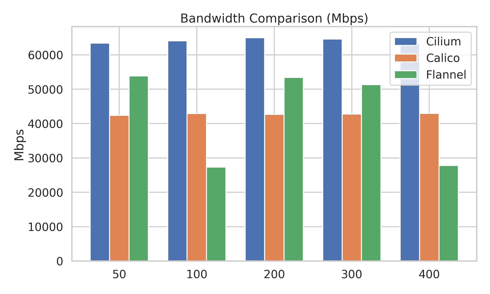

# Kubernetes CNI Benchmarks: Flannel vs Calico vs Cilium

Graduate Systems course project at IIIT Delhi (team of 5, guide: Dr Rinku Shah). We ran the same three-service
chain (A → B → C) under the same Locust load on three Container Network Interface plugins, on two kinds of
cluster:

- **Kind**: a 3-node cluster (1 control plane, 2 workers) whose nodes are Docker containers. Adds
  pod-to-pod traffic across nodes.
- **Bare metal**: a single-node `kubeadm` cluster on containerd, directly on the host (CachyOS). No Docker
  layer between the CNI data plane and the kernel. See [`baremetal-implementation/`](baremetal-implementation/).

Two more variants live in the repo: a VM setup ([`vm-implementation/`](vm-implementation/)) and a no-Kubernetes
baseline built from raw network namespaces, veth pairs and bridges
([`namespace-implementation/`](namespace-implementation/)).

Every setup is scripted in Bash: cluster creation, CNI install, workload deploy, load test, metrics, reset.
Prometheus and Grafana are installed with Helm for monitoring.

## Results

Load: Locust users at 50, 100, 200, 300 and 400, 1 minute each. Bandwidth: one `iperf3` run between two pods.
Ping: average of 3–5 ICMP round trips between pods. Each configuration was run **once**, so small differences
are within noise.

**Bandwidth (iperf3, pod to pod), median over the five load levels, Gbit/s**

| CNI | Bare metal (single node) | Kind (3 nodes) |
| --- | ---: | ---: |
| Flannel | 46.0 | 51.3 |
| Calico | 44.0 | 42.8 |
| Cilium (eBPF) | **54.2** | **64.1** |

**Throughput and latency at 400 users**

| CNI | Bare metal RPS | Bare metal p95 | Kind RPS | Kind p95 |
| --- | ---: | ---: | ---: | ---: |
| Flannel | 181.4 | 3 ms | 181.2 | 7 ms |
| Calico | 182.1 | 3 ms | 181.5 | 7 ms |
| Cilium | 181.7 | 3 ms | 181.4 | 7 ms |

What the numbers say:

- **Cilium moved the most data** in both clusters, about 18–23% more than Flannel and Calico on bare metal and
  50% more than Calico on Kind.
- **Requests per second are the same for every CNI.** Each Locust user waits 1–2 s between requests, so the
  load generator, not the network, sets the throughput. This workload does not stress any of the three data
  planes; a closed-loop load with no think time would be the next experiment.
- **Kind's p95 latency is about twice bare metal's** (7 ms vs 3 ms at 400 users), the cost of running nodes as
  Docker containers and crossing nodes.
- Flannel's Kind bandwidth swings between 27 and 54 Gbit/s across runs, which is why the table shows medians.

Raw rows: [`flannelresults.csv`](flannelresults.csv), [`calicoresults.csv`](calicoresults.csv),
[`ciliumresults.csv`](ciliumresults.csv) (Kind) and
[`baremetal-implementation/results/`](baremetal-implementation/results/) (bare metal). Plots are in
[`plots/`](plots/) and [`baremetal-implementation/results/plots/`](baremetal-implementation/results/plots/).



## Metrics collected

| Metric | Description |
| --- | --- |
| Users | Concurrent simulated Locust users |
| RPS | Requests per second handled by the service chain |
| p95 latency | 95th percentile response latency (ms) |
| CPU / memory (pods) | Aggregate pod usage from `kubectl top` |
| CPU / memory (nodes) | Node usage |
| Ping intra / inter | Pod-to-pod round trip on the same node / across nodes |
| Bandwidth | `iperf3` throughput between two pods (Mbit/s in the CSVs) |

## Running it

Requirements: Linux, Docker, `kind`, `kubectl`, `helm`, `jq`, root access for networking setup.

```bash
git clone https://github.com/vik-bit/GROUP6_GRSPROJECT.git
cd GROUP6_GRSPROJECT

# Kind cluster: one script per CNI (creates the cluster, installs the CNI, deploys, load-tests, records metrics)
sudo ./scripts/flannelsetup.sh     # or calicosetup.sh / ciliumsetup.sh

# Or step by step
make help
```

The Kind scripts fetch the reference CNI plugins (v1.4.1) with
[`cluster/fetch-cni-plugins.sh`](cluster/fetch-cni-plugins.sh) on first run.

Bare metal:

```bash
cd baremetal-implementation
sudo bash scripts/run_experiment.sh all   # reset → setup → CNI → deploy → test, for each CNI
```

Load tests append rows to the results CSVs in the repo root (Kind) or `baremetal-implementation/results/`.

## Layout

```
scripts/                    Kind setup per CNI, metrics collector
cluster/                    Kind cluster config, CNI plugin fetcher
k8s-manifests/              Service A/B/C deployments and services
microservices/              The three-service chain
load-test/                  Locust files
plots/                      Kind comparison plots and plotting scripts
baremetal-implementation/   kubeadm + containerd single-node setup and results
vm-implementation/          VM-based setup
namespace-implementation/   Raw Linux namespaces, veth and bridges, no Kubernetes
```

## Team

Bikram Mohanty ([vik-bit](https://github.com/vik-bit), team lead), Surya Deepak Boyina
([SuryaDeepakBoyina](https://github.com/SuryaDeepakBoyina)), Aayush Amritesh ([Ay-ritesh](https://github.com/Ay-ritesh)),
Shahnawaz ([ShahnawazDev](https://github.com/ShahnawazDev)) and
[kancharla25028-hub](https://github.com/kancharla25028-hub).
